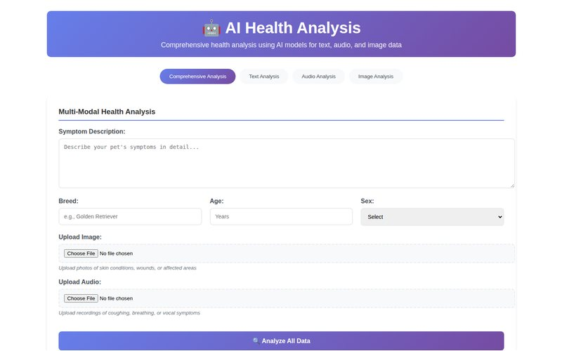
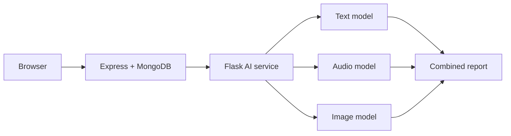
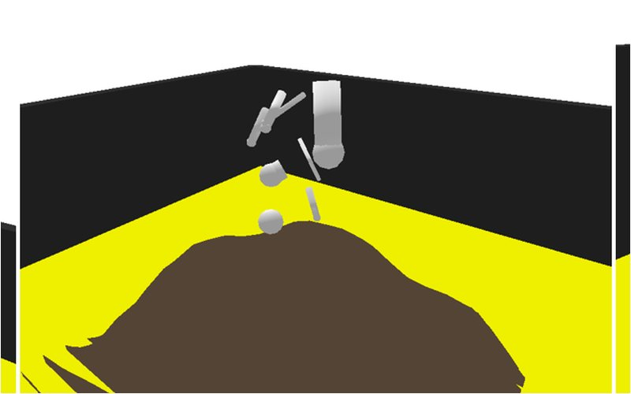
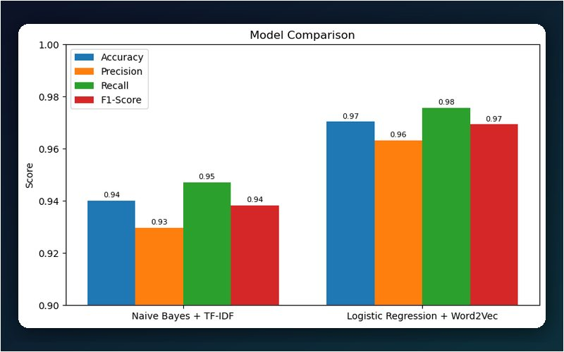
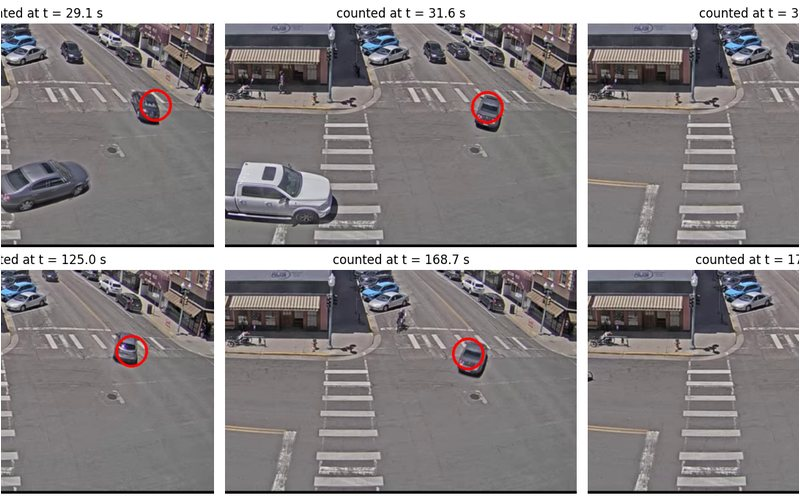
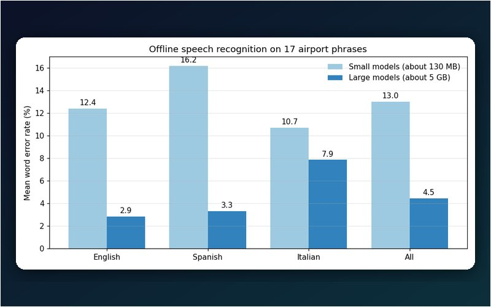
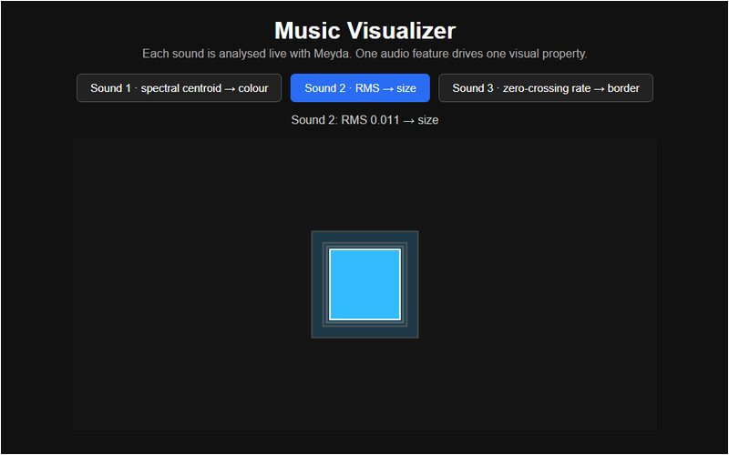
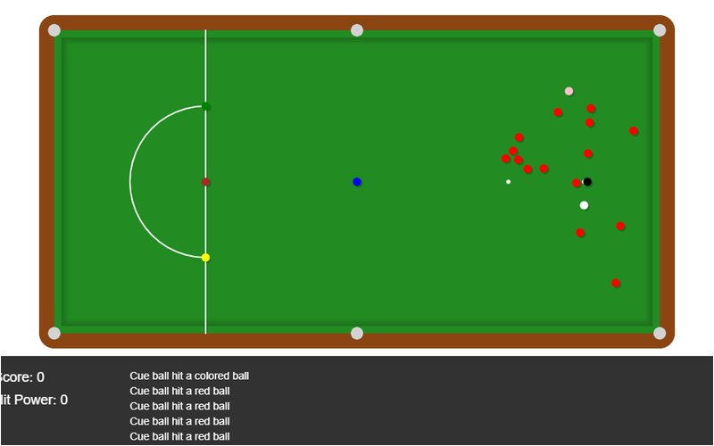

 

[**Portfolio site**](https://ziadelh.github.io/) &nbsp;·&nbsp; [**Featured**](#featured--pawlytics) &nbsp;·&nbsp; [**Selected work**](#selected-work) &nbsp;·&nbsp; [**All projects**](#all-projects) &nbsp;·&nbsp; [**Toolbox**](#toolbox) &nbsp;·&nbsp; [**Contact**](#get-in-touch)

 

## About

I build machine-learning systems **end to end**: collecting and cleaning data, training and honestly evaluating
models, and wrapping them in web apps that people can actually use. My graduation project combined three
deep-learning models — text, audio and image — into one assistant for dog health.

I care about the parts that make ML trustworthy: leak-free splits, class imbalance, reporting **held-out**
results, and being upfront about what a model can't do.

---

## Featured · Pawlytics

<table>
<tr>
<td width="46%" valign="middle">

</td>
<td valign="top">

### [Pawlytics](https://github.com/ziadelh/pawlytics)
*Graduation project · multimodal AI pet-health assistant*

Describe the symptoms, upload a photo, record a sound — three models run behind an Express + Flask app and
are merged by a rule-based step into one report with likely conditions, an urgency level and next steps.

| Modality | Model | Test accuracy |
|---|---|---|
| Text | Bio_ClinicalBERT · 20 conditions | 63.8 % |
| Audio | YAMNet + MLP · 8 sound classes | 71.9 % |
| Image | EfficientNet-B0 · 9 conditions | 73.2 % |

**[Repository](https://github.com/ziadelh/pawlytics)** · **[Model cards](https://github.com/ziadelh/pawlytics/blob/main/docs/MODEL_CARDS.md)**

</td>
</tr>
</table>

`PyTorch` · `TensorFlow` · `Hugging Face` · `Flask` · `Node.js` · `Express` · `MongoDB`

---

## Selected work

<table>
<tr>
<td width="33%" valign="top" align="center">
 
<b>Mountain-climbing creature</b> 
Genetic algorithm that evolves virtual creatures to climb a mountain in a PyBullet physics simulation. 
<code>Python</code> · <code>PyBullet</code>
</td>
<td width="33%" valign="top" align="center">
 
<b>Fake-news detection</b> 
Naive Bayes + TF-IDF vs Word2Vec + logistic regression: 94 % vs 97 % accuracy. 
<code>scikit-learn</code> · <code>NLTK</code> · <code>gensim</code>
</td>
<td width="33%" valign="top" align="center">
 
<b>Traffic car tracking</b> 
Detects, tracks and counts cars in traffic-camera footage with classical computer vision. 
<code>OpenCV</code> · <code>Kalman filters</code>
</td>
</tr>
<tr>
<td width="33%" valign="top" align="center">
 
<b>Speech-recognition assistant</b> 
Offline English / Spanish / Italian recognition with noise filtering and word-error-rate evaluation. 
<code>Vosk</code> · <code>Python</code>
</td>
<td width="33%" valign="top" align="center">
 
<b>Web audio apps</b> 
Real-time effects processor, audio CAPTCHA and two live visualisers in the browser. 
<code>p5.js</code> · <code>Web Audio</code> · <a href="https://ziadelh.github.io/web-audio-apps/">▶ demo</a>
</td>
<td width="33%" valign="top" align="center">
 
<b>Snooker</b> 
Physics-based snooker with three game modes and a guided tutorial. 
<code>p5.js</code> · <code>Matter.js</code> · <a href="https://ziadelh.github.io/snooker-game/">▶ play</a>
</td>
</tr>
</table>

---

## All projects

### Machine learning & AI

| Project | What it does |
|---|---|
| [**Pawlytics**](https://github.com/ziadelh/pawlytics) | Multimodal dog-health assistant: Bio_ClinicalBERT, YAMNet and EfficientNet-B0 behind Express + Flask. |
| [**Mountain-climbing creature**](https://github.com/ziadelh/artificial-intelligence-mountain-climbing-creature) | Genetic algorithm that evolves virtual creatures to climb a mountain in a PyBullet physics simulation — tree-shaped genome, multi-term fitness, tournament selection. |
| [**Fake-news detection**](https://github.com/ziadelh/fake-news-detection) | Naive Bayes + TF-IDF vs Word2Vec + logistic regression: **94 % vs 97 %** accuracy. |
| [**House-price prediction**](https://github.com/ziadelh/machine-learning-house-prices) | Under-fitting vs over-fitting vs a tuned Keras network with dropout and early stopping. |
| [**Loan approval**](https://github.com/ziadelh/machine-learning-loan-approval) | Decision tree and KNN written from scratch, PCA, nested cross-validation. |
| [**Movie revenue prediction**](https://github.com/ziadelh/movie-revenue-prediction) | Cleaning, statistics and linear / polynomial regression on 9,700 TMDb movies. |
| [**Web scraping & text analysis**](https://github.com/ziadelh/web-scraping-text-analysis) | Scrapes eight articles on virtual reality and compares them: word frequencies, bigrams, word cloud. |

### Computer vision & audio

| Project | What it does |
|---|---|
| [**Traffic car tracking**](https://github.com/ziadelh/traffic-car-tracking) | Detects, tracks and counts cars in traffic-camera footage with frame differencing, background subtraction and Kalman filters (OpenCV). |
| [**Speech-recognition assistant**](https://github.com/ziadelh/speech-recognition-assistant) | Offline multilingual (EN / ES / IT) airport assistant with Vosk — noise filtering and word-error-rate evaluation. |
| [**Audio steganography**](https://github.com/ziadelh/audio-steganography) | Finds a code hidden near 19 kHz and hides a message in least-significant bits (SciPy). |
| [**Media compression tools**](https://github.com/ziadelh/media-compression-tools) | Lossless audio compression with Rice coding built from scratch, plus an automatic film-format checker / converter (ffprobe, ffmpeg). |
| [**Web audio apps**](https://github.com/ziadelh/web-audio-apps) · [▶ demo](https://ziadelh.github.io/web-audio-apps/) | Real-time effects processor, audio CAPTCHA, Meyda visualiser and a voice-controlled visualiser. |
| [**Webcam image processing**](https://github.com/ziadelh/webcam-image-processing) · [▶ demo](https://ziadelh.github.io/webcam-image-processing/) | Live colour channels, thresholding, HSV / YUV conversion and face detection. |

### Apps & games

| Project | What it does |
|---|---|
| [**Vet clinic app**](https://github.com/ziadelh/vet-clinic-app) | Accounts, appointment booking with Google Maps, pet shop with cart and memberships. |
| [**Blog app**](https://github.com/ziadelh/blog-app) | Author and reader views, likes, comments and drafts. |
| [**Snooker**](https://github.com/ziadelh/snooker-game) · [▶ play](https://ziadelh.github.io/snooker-game/) | Browser snooker with Matter.js physics, three game modes and a tutorial. |
| [**Platformer**](https://github.com/ziadelh/platformer-game) · [▶ play](https://ziadelh.github.io/platformer-game/) | Side-scroller with coins, enemies, lives and a scrolling camera. |
| [**Drawing app**](https://github.com/ziadelh/drawing-app) · [▶ try](https://ziadelh.github.io/drawing-app/) | Eight tools, palette, undo, cut & paste, save to image. |
| [**Crypto trading simulator**](https://github.com/ziadelh/crypto-trading-simulator) | C++ console exchange with candlestick plots, built on a 1M-row order book. |
| [**DJ mixing app**](https://github.com/ziadelh/dj-mixing-app) | Two-deck mixer in C++ / JUCE: waveforms, faders, searchable library. |
| [**Porsche fan site**](https://github.com/ziadelh/porsche-website) · [▶ visit](https://ziadelh.github.io/porsche-website/) | Six-page site with slideshow, racing news and a 911 showcase. |

---

## Toolbox

**Strengths:** multimodal pipelines · NLP fine-tuning · class-imbalance handling · evaluation (F1, ROC-AUC,
confusion matrices) · model explainability · genetic algorithms · shipping models behind a web UI.

## Right now

- Continuing to develop **Pawlytics**
- Exploring vector search and memory-augmented models
- Learning **React** and getting more comfortable with **Docker**

---

## Get in touch

**Open to internships, collaboration and project opportunities.**

 

&nbsp;

&nbsp;

